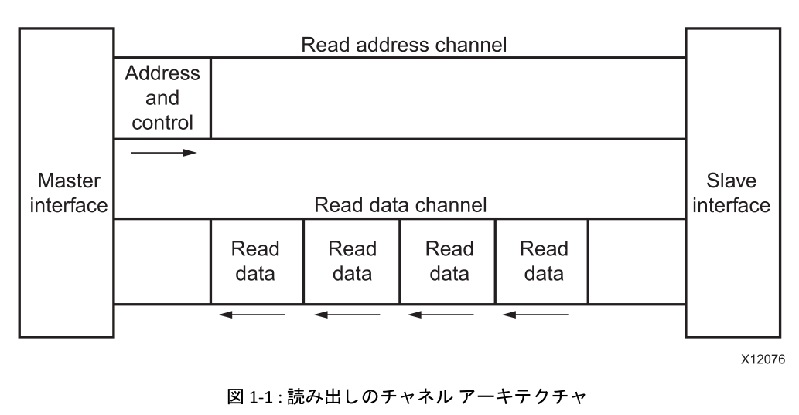
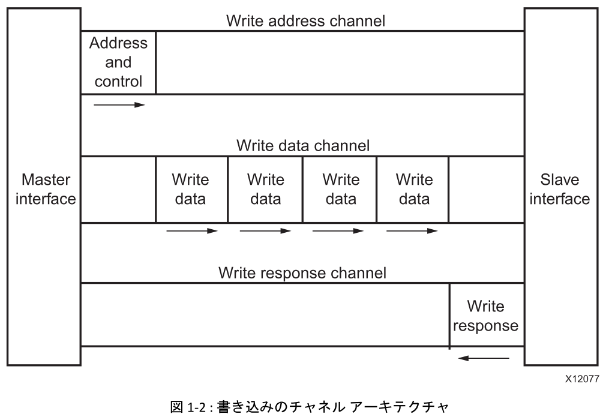
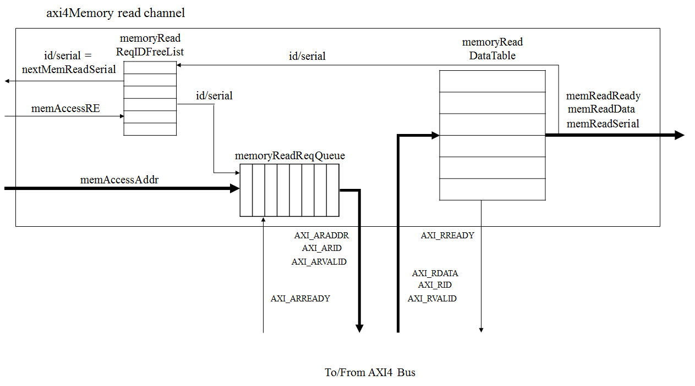
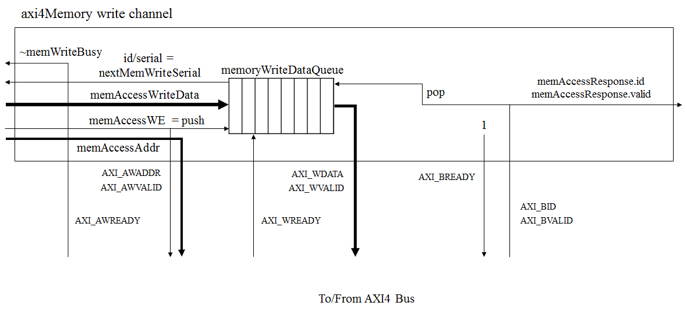

# DRAM controller on Zynq

See [Axi4Memory.sv](https://github.com/rsd-devel/rsd/blob/master/Processor/Src/Memory/Axi4Memory.sv) for the current implementation. The diagrams illustrate request/response concepts. Burst length is `MEMORY_ENTRY_BIT_NUM / MEMORY_AXI4_DATA_BIT_NUM`; check configuration rather than assuming that memory-transfer width equals cache-line width.

This page concerns Xilinx Zynq-7000. Read [System architecture](en-fpga-zynq-arch) first; the [Zynq reference manual](https://japan.xilinx.com/support/documentation/user_guides/j_ug585-Zynq-7000-TRM.pdf) supplies background.

## Overview

RSD occupies the PL, while external memory normally connects to the ARM-based PS. PL-to-PS access can use AXI4 high-performance ports HP0–3 or general-purpose ports GP0–1. This design uses an HP port. GP ports implement a broader set of AXI features; HP ports prioritize memory throughput.

AXI requests originate at a master and are handled by a slave, whose input/output directions complement the master's. The PS HP port is a slave. `Axi4Memory` provides the master interface and translates RSD read/write requests into AXI transactions.

## Read channel

RSD issues a read by setting `memAccessAddr` and asserting `memAccessRE`. The controller converts it to AXI address/ID/valid signals, illustrated as `AXI_ARADDR`, `AXI_ARID` and `AXI_ARVALID`.

AXI permits multiple outstanding reads identified by distinct IDs. `memoryReadReqIDFreeList` allocates IDs, while `memoryReadReqQueue` buffers requests before issue. Returned data reaches RSD through `memoryReadDataReady`, `memReadData` and `memReadSerial`.

An internal memory entry can span multiple AXI data beats. Burst transfers carry these beats, and `memoryReadDataTable` assembles them into the internal entry. Use the configured memory-entry/AXI-width ratio above for the burst count.

## Write channel

RSD writes by setting `memAccessAddr` and `memAccessWriteData`, then asserting `memAccessWE`. The controller generates AXI write-address signals, illustrated as `AXI_AWADDR`, `AXI_AWID` and `AXI_AWVALID`.

Multiple writes may be outstanding, but AXI4 write data must follow request order. Each internal entry is split into AXI beats as needed; `memoryWriteDataQueue` buffers pending data. The slave returns completion through `AXI_BID` and `AXI_BVALID`, allowing the completed data to leave the queue.

The documented flow assumes writes complete successfully; automatic request/data retry after a slave error is not implemented.
