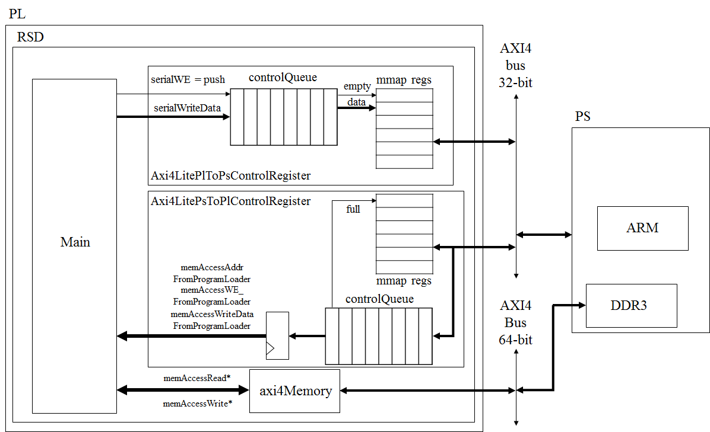

# System architecture on Zynq

This page describes RSD on Xilinx Zynq-7000 and assumes basic Zynq knowledge. See the [Zynq technical reference manual](https://japan.xilinx.com/support/documentation/user_guides/j_ug585-Zynq-7000-TRM.pdf) for background.

## Overview

Zynq contains a fixed Processing System (PS), centered on ARM processors, and reconfigurable Programmable Logic (PL). RSD occupies the PL. On typical Zynq boards, external DDR memory connects to the PS, so PL accesses pass through the PS. See the [DRAM controller](mem-controller.md) for `Axi4Memory`.

Two additional interfaces let ARM software communicate with RSD. `Axi4LitePlToPsControlRegister` exposes RSD output to ARM; `Axi4LitePsToPlControlRegister` carries ARM input to RSD. Both use AXI4-Lite memory-mapped registers. AXI4 is an [Arm bus protocol](http://infocenter.arm.com/help/index.jsp?topic=/com.arm.doc.dui0534b/index.html). Internal implementation details beyond these registers may change.

Bare-metal ARM software accesses physical addresses directly; see `Processor/Project/Vivado/TargetBoards/Zedboard/project_src/run_simple.c`. Under Linux, software opens and maps `/dev/uio*` devices through the Userspace I/O driver. The loader finds three devices by name in `/sys/class/uio/uio*/name`. It writes the guest image through `rsd-ram`, holds and releases the RSD core reset through `rsd-ps2pl`, and reads UART output through `rsd-pl2ps`. The kernel assigns their numbers at probe time. See [Linux on the PS](linux.md).
