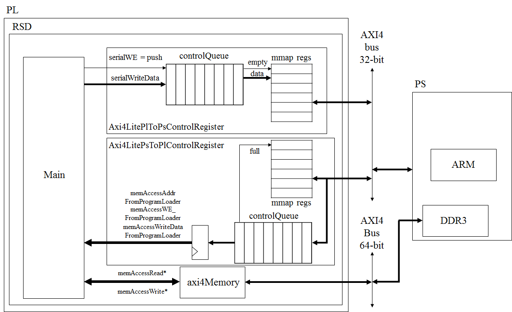

# ZYNQ 向けのシステムアーキテクチャ
ZYNQ 上に RSD を実装する際のシステムアーキテクチャについて説明します．
ここに書いてある内容は Xilinx Zynq-7000 向けです．
このページでは，ZYNQ についての基本的な知識は省略しています．
ZYNQ についての基本的な情報は [公式ドキュメント](https://japan.xilinx.com/support/documentation/user_guides/j_ug585-Zynq-7000-TRM.pdf) を参照してください．

## 概要 

おおまかに，ZYNQ は図のように ARM ハードプロセッサを中心に構成される非リコンフィギャラブルな PS (Processing System) 部と，FPGA を中心に構成されるリコンフィギャラブルな PL (Programmagle Logic) 部で構成されています．  
RSD は PL 部に実装します．  
特別なボードを除き，ZYNQ 搭載ボードにおける外部メモリ (DDR3 など) は PS 部に接続されており，PL 部から外部メモリには PS 部を介してアクセスする必要があります．  
メモリアクセスを担当する axi4Memory モジュールについては，[DRAM コントローラ](jp-fpga-zynq-mem-controller)を参照してください．  

axi4Memory の他に，PS 部の ARM プロセッサ上で動作するプログラムから RSD にアクセスするためのインターフェースを 2 種類実装しています．  
Axi4LitePlToPsControlRegister は基本的に ARM が RSD からの出力を取得するため，Axi4LitePsToPlControlRegister は ARM から RSD にデータを送るために使用します．\
どちらのモジュールも，PS 部 との通信には AXI4 Lite プロトコルで規定されたインターフェースを持つメモリマップドレジスタ (mmap regs) を利用します．  
AXI4 とは，[ARM が策定するバス用通信プロトコル](http://infocenter.arm.com/help/index.jsp?topic=/com.arm.doc.dui0534b/index.html) です．   
各モジュールの中について，mmap regs 以外のアーキテクチャは今後大幅に変更になる可能性があるため，ここでは言及しません

ARM 上で OS が動いていない場合は，これらのレジスタには物理アドレスを用いて直接アクセスします．  
(例: Processor/Project/Vivado/TargetBoards/Zedboard/project\_src/run\_simple.c)\
一方，OS が動作している場合は物理アドレスは使えないため，UIO (Userspace I/O) ドライバでインストールされた /dev/uio* デバイスファイルをopen，mmap することでアクセスします．  
/dev/uio1 が Axi4LitePlToPsControlRegister，/dev/uio2 が Axi4LitePsToPlControlRegister です．  
Linux についての詳細は [ZYNQ の PS 向けの Linux](jp-fpga-zynq-linux) を参照してください．
