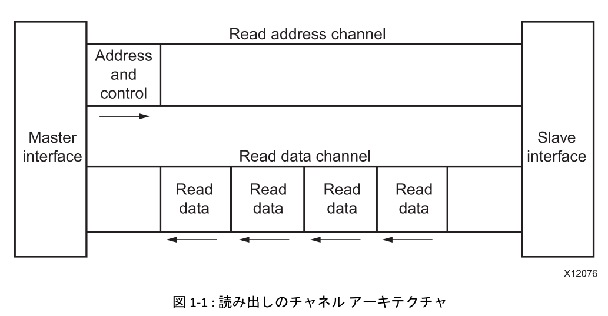
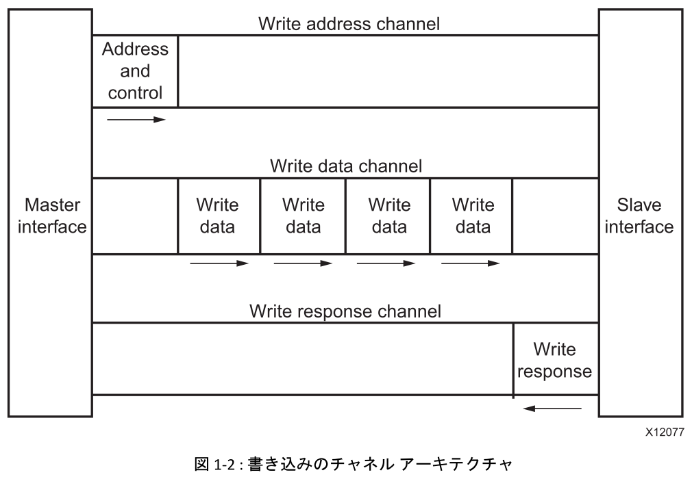
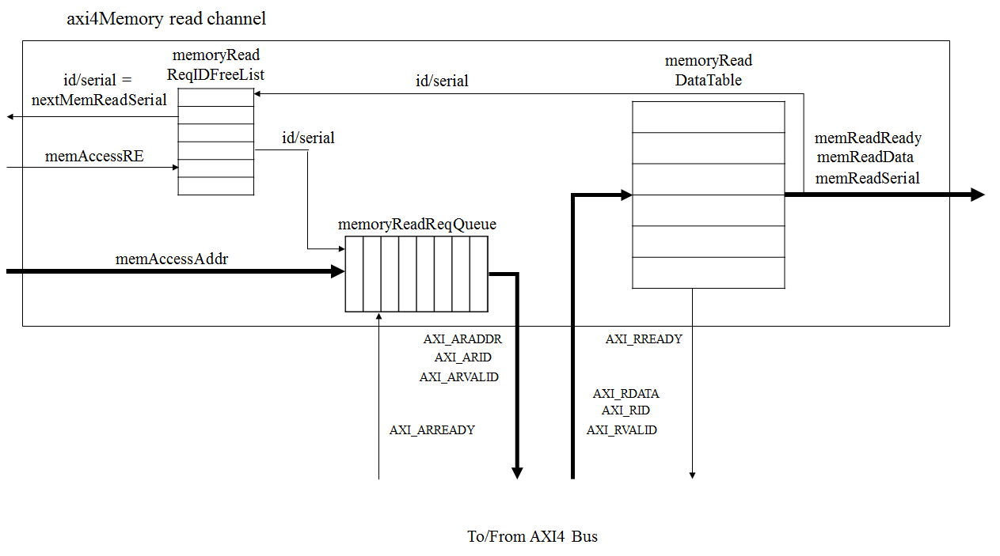
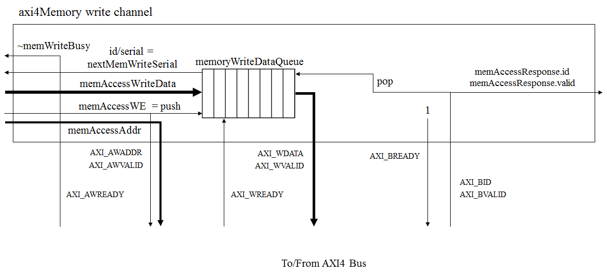

# DRAMコントローラ (ZYNQ編)

現在の実装は [Axi4Memory.sv](https://github.com/rsd-devel/rsd/blob/master/Processor/Src/Memory/Axi4Memory.sv) を参照してください．以下の図は要求・応答の概念を示します．実装上のバースト長は `MEMORY_ENTRY_BIT_NUM / MEMORY_AXI4_DATA_BIT_NUM` で決まります．キャッシュライン幅とメモリ転送幅を同一と仮定せず，設定値を確認してください．
ZYNQ 上のプロセッサで DRAM を読み書きするのに必要な DRAM コントローラについて説明します．  
ここに書いてある内容は Xilinx Zynq-7000 向けです．  
このページでは，ZYNQ についての基本的な知識は省略しています．  
ZYNQ についての基本的な情報は[公式ドキュメント](https://japan.xilinx.com/support/documentation/user_guides/j_ug585-Zynq-7000-TRM.pdf)を参照してください．  
また，このページの記述は[Zynq向けのシステムアーキテクチャ](arch.md)のシステムアーキテクチャを前提としたものとなっているので，先にそちらを読むことをお勧めします．\

## 概要 

おおまかに，ZYNQ は ARM ハードプロセッサを中心に構成される非リコンフィギャラブルな PS (Processing System) 部と，FPGA を中心に構成されるリコンフィギャラブルな PL (Programmagle Logic) 部で構成されています．  
RSD は PL 部に実装します．  
特別なボードを除き，ZYNQ 搭載ボードにおける外部メモリ (DDR3 など) は PS 部に接続されており，PL 部から外部メモリには PS 部を介してアクセスする必要があります．  

PL 部から PS 部にアクセスする方法は，図の AXI4 High performance port (HP0~3) か AXI4 General-purpose port (GP0~1) を利用します．  
AXI4 とは，ARM が策定するバス用通信プロトコル([公式ドキュメント](http://infocenter.arm.com/help/index.jsp?topic=/com.arm.doc.dui0534b/index.html)) です．  
AXI4 General-purpose port は AXI4 プロトコルのほぼすべての機能が実装されているのに対し，AXI4 High performance port は一部の機能を排すことで高性能 (高スループット) なポートになっています．  
今回は AXI4 High performance port を使用します．

AXI4 プロトコルでは，通信はマスターとスレーブの 2 者間で行われます．  
マスターとスレーブはそれぞれ入出力関係が逆のインターフェースを持ち，マスターとマスター，スレーブとスレーブが通信を行うことはできません．  
通信は，マスターが要求を出し，スレーブが要求に応じてデータを処理します．  
図はそれぞれ読出しと書き込み処理の概要図です．  

前述の外部メモリと通信するための PS 部の High performance port はスレーブインターフェースになっています．  
そのため，RSD 側で必要なことは AXI4 プロトコルで策定されたマスターのインターフェースを持ち，AXI4 プロトコルでメモリアクセス要求を発行，処理できるようにすることです．  
ソースコード中の Processor/Src/Memory/Axi4Memory.sv が，RSDからのリード/ライト要求を AXI4 プロトコルのリード/ライト要求に変換しています．\

## リードチャンネル 

RSD からのリード要求は，memAccessRE と memAccessAddr によって発行されます．
具体的には， リード要求のアドレスを memAccessAddr にセットして memAccessRE を 1 にすることでリード要求が発行されたことになります．\
そのため，axi4Memory モジュール内ではその要求を受け取り，AXI4 プロトコルに変換してメモリに送ります．  
変換された要求が図の AXI\_ARADDR ，AXI\_ARID，AXI\_ARVALID です．  
詳細は AXI4 のドキュメントを参照してください．  

リードのスループットを向上させるため，AXI4 では 1 つのリード要求を処理中に別のリード要求を発行することができます．  
それぞれのリード要求は固有の ID で管理されます．  
こうした並行処理を可能にするため， axi4Memory モジュールにはそれぞれのリード要求に対して固有の ID を発行する memoryReadReqIDFreeList と，要求を発行するまで一時的にバッファする memoryReadReqQueue があります．  

メモリからデータが到着すると，そのデータを memoryReadDataReady ，memReadData，memReadSerial を介して RSD に受け渡します．  
ここで注意しなければならないことは，RSD のメモリ要求におけるデータの単位であるキャッシュラインサイズより AXI4 インターフェースのデータサイズが一般的に小さい点です．  
これは，PS 部の HP ポートや内部バス，メモリコントローラのデータ幅が制限されていることによります．  
そのため，axi4Memory では 1 つの RSD のリード要求に対してバースト転送を行います．  
バースト数は `MEMORY_ENTRY_BIT_NUM / MEMORY_AXI4_DATA_BIT_NUM` で決まります．
memoryReadDataTable は，バースト転送で送られてきたデータを内部メモリエントリのサイズに結合する役割を担います．

## ライトチャンネル 

RSD からのライト要求は，memAccessWE と memAccessWriteData， memAccessAddr によって発行されます．
具体的には， ライト要求のアドレスを memAccessAddr に，データを memAccessWriteData にセットして memAccessWE を 1 にすることでライト要求が発行されたことになります．\
そのため，axi4Memory モジュール内ではその要求を受け取り，AXI4 プロトコルに変換してメモリに送ります．  
変換された要求が図の AXI\_AWADDR ，AXI\_AWID，AXI\_AWVALID です．  
詳細は AXI4 のドキュメントを参照してください．  

リードチャネルと同様に，ライトチャネルでは 1 つのライト要求を処理中に別のライト要求を発行可能です．  
しかし，AXI4 プロトコルの規定により，書き込むデータの転送順番は要求を出した順番にならなければなりません．  
また，リードチャネルと同様に RSD のメモリ要求におけるデータの単位であるキャッシュラインサイズより AXI4 インターフェースのデータサイズが一般的に小さい点に注意が必要です．  
そのため，同様に axi4Memory では 1 つの RSD のライト要求に対してバースト転送を行います．  
バースト数は `MEMORY_ENTRY_BIT_NUM / MEMORY_AXI4_DATA_BIT_NUM` で決まります．
memoryWriteDataQueue は，バースト転送で送るデータを一時的にバッファする役割を担います．

書き込みが正常に終了すると，スレーブ側から AXI\_BID と AXI\_BVALID を介して書き込み完了応答が発行されます．
この完了応答をもってライト要求は完了し，memoryWriteDataQueue からデータが削除されます．
本来，ここで正常に書き込みが終了しなかった場合にライト要求とデータを再送する処理が必要なのですが，現在はすべての書き込みは必ず正常に完了することを想定してこの処理は未実装です．

TODO\
スレーブ側で書き込みが失敗した場合に，ライト要求とデータを再送する機構の追加
